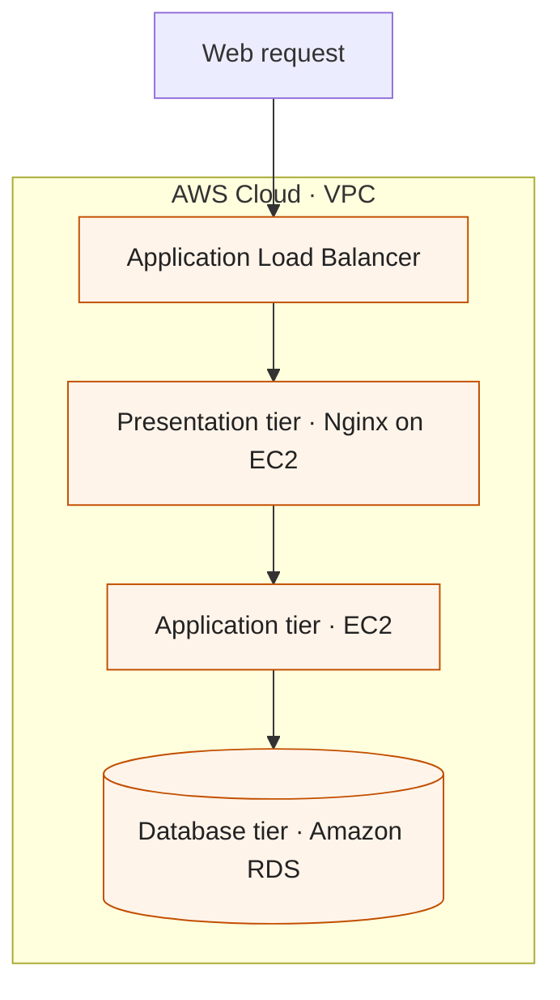

<h1 align="center">☁️ Bharanidharan J T</h1>

<strong>Cloud infrastructure · DevOps · Linux</strong>

I’m a Computer Science and Engineering graduate interested in junior Cloud Engineer and DevOps roles. I’ve migrated MySQL from EC2 to RDS, built a Jenkins pipeline to test and deploy a containerized application, and completed a six-month Cloud Computing & DevOps internship at QUBINEX Smart IT Solutions.

💼 LinkedIn · 📬 Email · 📂 Repositories

🧭 Explore my work · 🚀 Projects · 🧰 Tools I work with · 💼 Internships · 🎓 Education and training

🚀 Projects

<strong>☁️ Three-tier AWS architecture</strong>
🎯 Goal — Separate the web, application, and database layers of an AWS deployment.

🛠️ My work — I deployed a web application with separate presentation, application, and database tiers. I configured an Application Load Balancer, EC2 instances, VPC networking, security groups, and Amazon RDS.

🧰 Stack — Application Load Balancer · EC2 · VPC · RDS · Nginx

🗺️ Architecture

<strong>🔄 Cloud & DevOps CI/CD pipeline</strong>
🎯 Goal — Automate the steps between a source change and application deployment.

🛠️ My work — I connected GitHub, Jenkins, and Docker to automate application builds, testing, containerization, and deployment on AWS.

🧰 Stack — Git · GitHub · Jenkins · Docker · Linux · AWS

🔄 Deployment flow
GitHub → Jenkins build and test → Docker image → Application deployment

<strong>⚡ AWS Lambda cost optimization</strong>

🎯 Goal — Use event-driven automation to manage resource utilization and track function health.

🛠️ My work — I built event-driven automation in Python to improve AWS resource utilization. I configured CloudWatch to monitor Lambda executions, errors, and performance.

🧰 Stack — Python · Lambda · CloudWatch · IAM · S3

<strong>🗄️ EC2 to RDS database migration</strong>

🎯 Goal — Move an EC2-hosted MySQL database to a managed database service.

🛠️ My work — I migrated a MySQL database from EC2 to Amazon RDS using AWS Database Migration Service. I configured VPC networking and security groups for application-to-database connectivity.

🧰 Stack — MySQL · EC2 · AWS DMS · RDS · VPC

<strong>📦 On-premises application migration</strong>

🎯 Goal — Recreate an on-premises application environment on AWS.

🛠️ My work — I moved an application environment to AWS and configured its compute, storage, network, and database services using EC2, S3, VPC, RDS, Linux, and Nginx.

🧰 Stack — EC2 · Linux · Nginx · S3 · RDS · MySQL

<strong>📣 Digital notice board and alert management</strong>

🎯 Goal — Help users publish notices and receive reminders before deadlines.

🛠️ My work — I built a React and Django platform for publishing notices, authenticating users, and sending deadline reminders by email.

🧰 Stack — React · Django · Python · SQLite · Gmail SMTP

🧰 Tools I work with

Area	My toolkit
☁️ AWS infrastructure	EC2 · VPC · S3 · RDS · Application Load Balancer
⚡ Automation and monitoring	Lambda · CloudWatch · IAM · AWS DMS
🚀 Delivery	Git · GitHub · Jenkins · Maven · Docker · Ansible · Kubernetes
🐧 Systems	Linux · Bash · Python · Nginx · PuTTY · WinSCP
🗄️ Data	MySQL · MariaDB · SQLite · Power BI
🧩 Application development	React · Django · VS Code

💼 Internships
☁️ Cloud & DevOps practice — At QUBINEX, I worked with AWS services, Linux, and application deployment. My earlier internships introduced me to cloud deployment at Shahar Technologies and sensor integration and device communication at IMAGECON.
Role	Organization	Duration
Cloud Computing & DevOps Intern	QUBINEX Smart IT Solutions	6 months · 2026
Cloud Computing Intern	Shahar Technologies (OPC) Private Limited	1 month · 2025
Python & IoT Intern	IMAGECON India Private Limited	1 month · 2022

🎓 Education and training
- B.E. in Computer Science and Engineering · University College of Engineering · May 2026 · CGPA 7.8
- Diploma in Computer Science and Engineering · Government Polytechnic College · June 2023 · 90%
- Cloud Computing & DevOps · ACTE Technologies, Bangalore · Three-month training certificate · 2026
